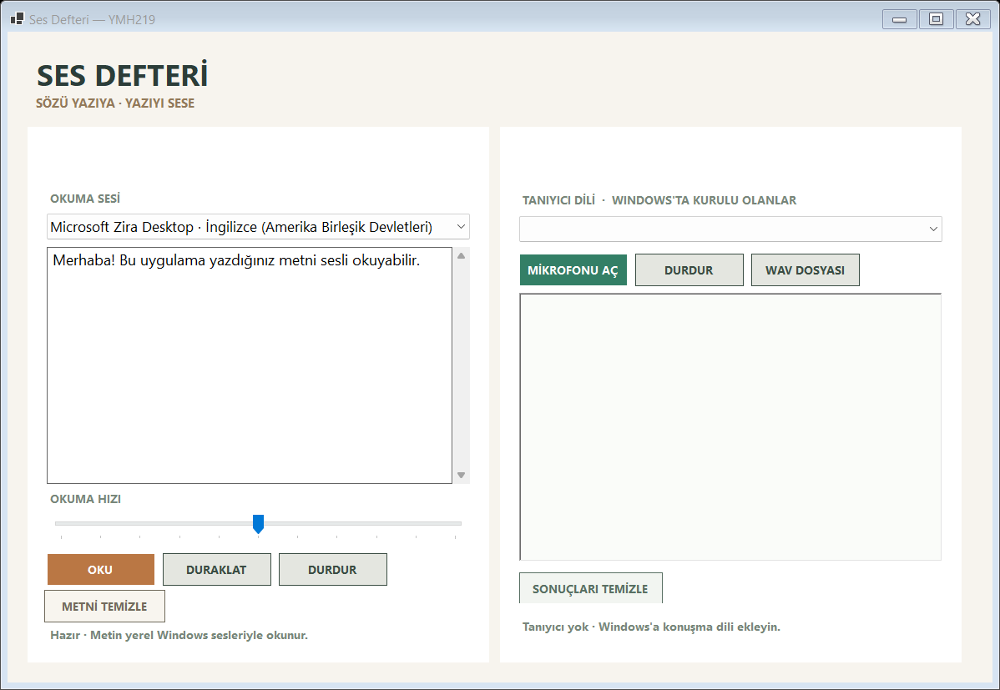
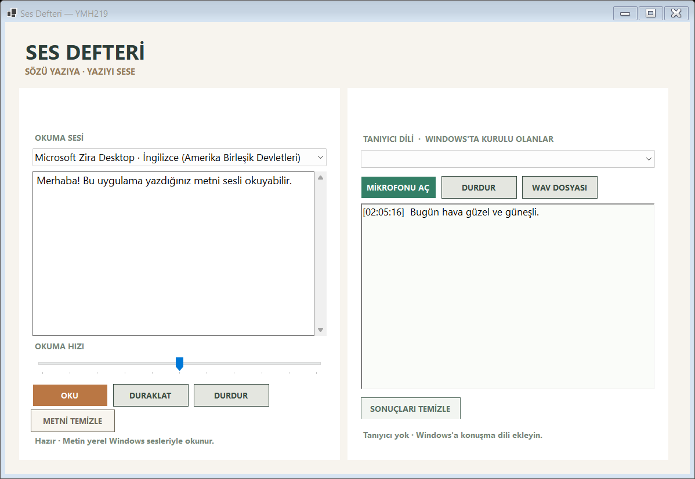

# YMH219 — Ses Defteri

Windows'un yerel konuşma sentezi ve tanıma altyapısını kullanan çift yönlü bir Speech-to-Text / Text-to-Speech Windows Forms uygulamasıdır.

## Teknoloji

- C# / .NET 10, Windows Forms
- [`System.Speech` 11.0.0](https://www.nuget.org/packages/System.Speech/11.0.0)
- Microsoft Speech API; konuşma tanıma ve sentezleme Windows'ta çalışır

## Özellikler

- Metin kutusundaki yazıyı seçilen Windows sesiyle okuma
- Okuma hızı seçimi, duraklatma, devam ettirme ve durdurma
- Kurulu konuşma tanıyıcılarını dil etiketiyle listeleme
- Mikrofonla tanıma ve ayrı WAV dosyasıyla tanıma seçeneği
- Tanıma sonuçlarını zaman damgasıyla gösterme; sonuçları temizleme
- Yalnızca Windows'ta kurulu ses/dil altyapısını kullanır; çevrimiçi servise ses göndermez

## Kurulum ve çalıştırma

```powershell
git clone https://github.com/Halit1elnehsen/YMH219-SpeechApp.git
cd YMH219-SpeechApp
dotnet restore
dotnet run
```

Windows 10/11 ve .NET 10 SDK gerekir. NuGet paketi ilk geri yüklemede indirilir. Ses seçimi Windows'ta etkin olan seslerden yapılır. Tanıyıcı yoksa Windows **Ayarlar > Saat ve Dil > Konuşma** bölümünden uygun konuşma tanıma dilini kurup uygulamayı yeniden açın. Türkçe/İngilizce seçenekleri yalnızca ilgili ses veya tanıyıcı Windows'a kurulmuşsa görünür.

## Ekran görüntüleri





## Test ve sınırlamalar

Bu cihazda Windows API'si 0 konuşma tanıyıcısı ve 2 sentez sesi bildirdi. Kurulu `Microsoft Zira Desktop` sesiyle WAV çıktısı oluşturma ve seçilen sesin TTS işlevi doğrulandı. Tanıyıcı olmadığından WAV ile STT ve gerçek mikrofonla STT ayrı ayrı denenemedi. Yüklü Windows seslerinden seçim yapılabiliyor, ancak Türkçe tanıyıcı/ses bu cihazda mevcut değildi. Tanıma kalitesi Windows dil paketine, mikrofon aygıtına ve ortam gürültüsüne bağlıdır.

## Öğrenci

**Halid Elnehsen — 250541617**
